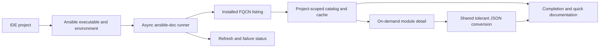
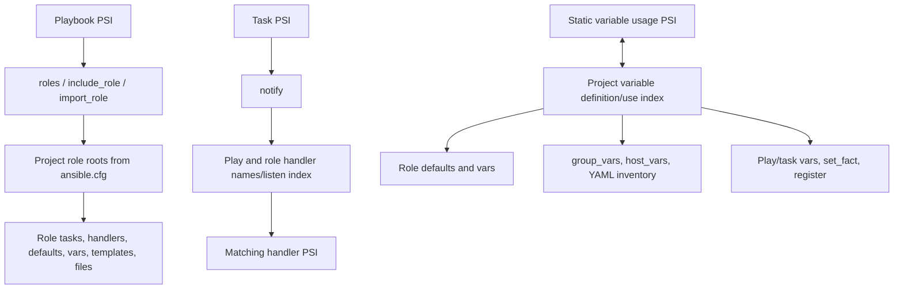

# Ansible Project Navigation - Plan

## Goal Capsule

Add project-aware Ansible intelligence to the IntelliJ plugin so a developer can follow relationships across playbooks, roles, handlers, templates, files, and variable sources. Discover module documentation from the Ansible installation selected for the project, including installed collections, instead of treating a checked-in list of six names as the supported module set.

**Outcome:** From a playbook or role file, completion, documentation, and navigation follow Ansible names and static project structure, while the plugin remains usable when Ansible is absent or its CLI fails.

**Primary users:** IntelliJ users editing Ansible playbooks and role repositories.

**Execution boundary:** Implement through the units below. Do not execute playbooks or evaluate Jinja.

---

## Product Contract

### Problem Frame

The plugin currently recognizes a small fixed module list whose JSON fixtures are under test resources. Role lookup scans for a conventional task entry point and does not honor project `roles_path`. Role files outside tasks and handlers are not consistently classified, `notify` is plain text, and variable fields do not connect definitions to uses. These limits make navigation stop at the playbook boundary even for projects split into related role groups.

### Requirements

**Module discovery and documentation**

- **R1.** Treat `ansible-doc -t module -l --json` from the project-selected Ansible environment as the source of installed module identities. Include FQCN modules from Ansible collections; retain a short name only when it maps to one unambiguous FQCN.
- **R2.** Load a module’s detail documentation on demand with `ansible-doc -t module -j <FQCN>`. Parse tolerant JSON while preserving module identity, options, aliases, examples, return values, and documentation needed by existing completion and quick documentation.
- **R3.** Let the user select an Ansible executable per project, defaulting to `ansible-doc` found through the IDE process PATH. Run discovery asynchronously from the project root, inherit the IDE process environment, and honor project `ansible.cfg`. Cache per project and executable/environment context; refresh when relevant settings change and through an explicit refresh action. In project-level Ansible settings, show initial loading, ready, unavailable-before-first-success, and failed-refresh-with-last-good states; include the failure reason and a refresh action. Keep last-known-good catalog data for that same context after a transient failure. A missing executable or failed command must not disable unrelated plugin functions.

**Playbook and role navigation**

- **R4.** Recognize short and FQCN forms of `include_role` and `import_role`, including task action-key and `ansible.builtin.*` forms. Resolve role declarations to directories in configured `roles_path` roots and the project’s conventional local `roles` root.
- **R5.** Resolve `notify` names and `listen` topics to matching handlers in the effective play or role context, including handler files where supported by the role layout.
- **R6.** Provide contextual file completion and navigation for `template.src` under role `templates/` and `copy.src` under role `files/`, preserving existing generic path behavior outside recognized Ansible role fields.
- **R7.** Classify role `tasks`, `handlers`, `defaults`, `vars`, `templates`, and `files` as Ansible-related sources as appropriate, and resolve role roots using project `ansible.cfg` `roles_path`, including multiple roots and paths relative to the configuration file.

**Static variable navigation**

- **R8.** Link statically recognizable variable usages to plausible definitions and link definitions to usages across role defaults/vars, play/task vars, `set_fact`, `register`, `group_vars`, `host_vars`, and YAML inventory. Form candidates from statically associated play, role, host, and group scopes; do not link an unrelated same-name variable as a direct match. Support common Jinja interpolation and condition expressions without evaluating them.
- **R9.** Keep variable navigation static and multi-target when several definitions may apply. Show source/scope context so users can inspect alternatives. When a static scope relationship cannot be established, label broader project-wide matches as scope-unknown candidates instead of implying they are applicable. Do not calculate runtime variable precedence, resolve dynamic inventory, parse INI inventory, or evaluate Jinja.

**Compatibility and resilience**

- **R10.** Preserve current completion, documentation, and path behavior where new Ansible-specific recognition does not apply. Project-specific state must not leak between open projects, and an unavailable Ansible CLI must not prevent editing or navigation based on already available project data.

### Key Decisions

- **D1 — Installed module inventory (Governs: R1):** Use the selected environment’s `ansible-doc -t module -l --json` result as the authority for installed modules. The test fixture’s six short names are not the product boundary. **session-settled: user-directed — chosen over a fixed six-name catalog.**
- **D2 — Runtime environment (Governs: R3):** Query the selected project Ansible installation from the IDE and load detail docs on demand, instead of shipping one build-time catalog. Projects can use different Ansible and Galaxy installations. **session-settled: user-approved — chosen over a build-time bundled snapshot.**
- **D3 — Module identity:** Store and resolve modules by FQCN. Offer short-name compatibility only when it is unique in the current catalog; ambiguous short names require an FQCN.
- **D4 — Variables (Governs: R8, R9):** Build static definition/use links and show all plausible targets with their source context. Do not evaluate Jinja or calculate precedence. **session-settled: user-approved.**
- **D5 — CLI failure behavior:** Keep last-good data for the identical project/environment context and surface loading, ready, and failure states in project-level Ansible settings, including a refresh action. Do not silently borrow a catalog from another project or executable.
- **D6 — Scope:** Support YAML inventory and the listed static variable sources. Restrict direct variable matches to statically associated play, role, host, and group scopes; label candidates with unknown scope separately. Dynamic inventory, INI inventory, execution of playbooks, and non-module plugin catalogs remain out of scope.

### Key Flows

- **F1 — Discover and document a module:** The user opens a project with Ansible available. The plugin discovers module FQCNs in the background, then fetches the selected module’s detail when needed. Module completion and documentation reflect that environment; a failure leaves the editor responsive and exposes the discovery status.
- **F2 — Follow role and handler links:** From a playbook role declaration or an `include_role`/`import_role` task, the user navigates to the configured role root. From a task’s `notify`, the user navigates to a matching handler or `listen` topic in its play/role scope.
- **F3 — Follow role files and variables:** From a `template.src` or `copy.src` value, the user completes/navigates to the role-local source file. From a variable usage, the user can inspect plausible definitions; from a definition, the user can inspect static usages, including inventory overrides.

### Acceptance Examples

- **AE1.** Given two projects using different Ansible installations, module completion shows each project’s installed FQCN set; one project never receives the other project’s catalog.
- **AE2.** Given a module available only through an installed collection, its FQCN appears in completion and its detail is available on demand. Given two modules with the same short name, short-name resolution is not guessed.
- **AE3.** Given `include_role: name: web` or `ansible.builtin.import_role: name: web`, navigation resolves `web` in the project’s configured role roots, including two `roles_path` entries and config-relative paths.
- **AE4.** Given `notify: restart web` and a handler named or listening as `restart web` in the effective role/play scope, navigation resolves the handler; a same-named handler in an unrelated scope is not selected.
- **AE5.** Given `template: src: nginx.conf.j2` and `copy: src: limits.conf`, completion and navigation use the role’s `templates/` and `files/` directories respectively, while an unrelated generic path remains current-file-relative.
- **AE6.** Given a variable used in a task and definitions in its role defaults plus a statically related `group_vars` entry, navigation returns both plausible definitions with source context; a same-named definition in an unrelated role is not a direct match. If the group relationship cannot be derived, its candidate is labeled scope-unknown. Usages from Jinja expressions link back to the definition. No runtime precedence winner is claimed.

### Success Criteria

- Existing module completion/documentation behavior is represented by tests using a fake `ansible-doc` process and fixture JSON, without requiring a host Ansible install in CI.
- All supported installed FQCN modules are discoverable from the selected project environment; details are fetched on demand and converted into the plugin’s model.
- Cross-project cache isolation and failure recovery are observable in tests.
- IntelliJ fixture tests demonstrate role, handler, role-file, and static variable references through PSI references and completion.
- A local smoke check against an installed Ansible environment confirms catalog and detail parsing, including the installed collection set when available.

### Scope Boundaries

- Included: module plugins; project-selected `ansible-doc`; FQCN and unambiguous short aliases; project `ansible.cfg` role paths; role/play YAML navigation; static YAML variable sources; completion, quick docs, and PSI navigation.
- Excluded: lookups, filters, callbacks, connection plugins or other plugin catalogs; Galaxy role installation/management; dynamic inventory execution; INI inventory parsing; Jinja evaluation; runtime precedence calculation; playbook execution; automatic installation or mutation of Ansible environments.

---

## Planning Contract

### Key Technical Decisions

- **KTD1 — Isolate project environment access behind a service.** Add a project-level service for executable settings, asynchronous process execution, catalog/detail cache, and refresh/status. Existing model loading is global/static (`AnsibleModels`, `AnsibleTask.TYPE`) and the schema API has no project parameter. Keep project-specific data out of those singletons: resolve the active project catalog at the IDE integration boundary and pass the applicable module model into completion/documentation. This prevents cross-project contamination and gives tests a fake process boundary.
- **KTD2 — Parse the public listing and detail commands.** Use `ansible-doc -t module -l --json` for enumeration and `ansible-doc -t module -j <FQCN>` for selected detail. Do not depend on `--metadata-dump`, which official documentation marks internal. Keep parsing tolerant because detail JSON is not a frozen plugin API; validate minimum required fields and report malformed output while retaining same-context last-good data.
- **KTD3 — Preserve FQCN through conversion.** Reshape the converter so its output keys and runtime model retain FQCN, even though `doc.module` commonly contains only a short name. Put any FQCN-to-short alias index beside the catalog and compute ambiguity rather than overwriting entries. Reuse or consolidate the extractor DTO/converter and runtime DTO instead of creating another parallel schema.
- **KTD4 — Use PSI reference providers for navigation.** Follow the existing `ReferenceProvider`, `AnsibleReferenceContributor`, and fixture conventions. Add narrow reference providers for role invocation, handler notification, role source paths, and variables. Keep generic `YamlFilePathType` references as the fallback when the Ansible-specific field/root cannot be established.
- **KTD5 — Resolve roles from project context.** Parse project `ansible.cfg` role path roots and normalize relative roots against that config file’s directory. Add the conventional project `roles/` root. Search configured roots deterministically and avoid assuming all projects place roles under one directory. Limit matching to YAML role documents and the supported role file conventions.
- **KTD6 — Make variable links static, many-to-many, and scope-aware.** Index supported definitions and usages with their statically derivable play, role, host, and group relationships. Expose all plausible in-scope PSI targets with source context; when scope cannot be established, mark broader matches as scope-unknown rather than direct matches. Reuse YAML PSI and avoid building an expression evaluator. Keep the candidate set bounded to the supported YAML source categories and recognizable Jinja/condition forms.

### High-Level Technical Design

The plan describes boundaries, not a required class layout. The implementation should preserve the current plugin extension points where they fit.

### Phased Delivery

1. **Environment/catalog foundation:** Project settings and asynchronous runner; fakeable process boundary; catalog listing, FQCN identity, on-demand detail conversion, per-project cache and failure status.
2. **Ansible source and role roots:** Broaden YAML source classification and resolve project/config role roots.
3. **Role and handler edges:** Add `include_role`/`import_role` references and handler `notify`/`listen` links with scope-aware resolution.
4. **Role file edges:** Add role-aware completion and navigation for template and copy source fields.
5. **Variable graph:** Add static definitions/usages across the agreed source categories with multiple targets and source labels.
6. **Integration and documentation:** Run project checks, review and simplify the implementation, update user-facing documentation and settings descriptions, and record any intentionally deferred limits.

### Risks & Dependencies

- **CLI availability or environment mismatch:** The IDE may not inherit the shell PATH or environment. Mitigation: configurable executable, project base directory, explicit process environment handling, visible status, fake runner tests, and an optional local smoke check.
- **CLI output shape changes:** `ansible-doc` JSON may change. Mitigation: tolerant parsing, minimum-field validation, fixtures for representative public output, and non-fatal same-context last-good fallback. Do not rely on the internal metadata dump.
- **Installed FQCN inventory differs by project:** Global static model state can leak data. Mitigation: project-scoped service/cache and explicit tests opening projects with different fake inventories.
- **Short-name collisions:** Collections can provide duplicate short names. Mitigation: FQCN as identity and only offer a short alias when unique.
- **Ansible role path variations:** Config may contain multiple roots, relative paths, or unset defaults. Mitigation: deterministic root normalization and fixture cases for multiple roots and paths relative to the config file; document any unsupported interpolation or environment expansion discovered during implementation.
- **Handler matching can cross scopes incorrectly:** Same handler names may exist in multiple roles or plays. Mitigation: match in the effective play/role context, include `listen` topics, and test unrelated duplicate names.
- **Static variable candidates can be noisy:** Static analysis cannot compute precedence or dynamic values. Mitigation: show every plausible target with source context, constrain scanned source types, and test multiple definitions explicitly.
- **Static variable scope is incomplete:** Some inventory/host relationships or dynamic Ansible expressions may not be statically derivable. Mitigation: show direct links only for derivable relationships, label broader matches as scope-unknown, and test that unrelated same-name definitions are not direct matches.
- **PSI indexing cost:** Project-wide variable and role indexes may affect responsiveness. Mitigation: use IntelliJ indices/PSI facilities and cancellable background work; measure fixture and local behavior before widening the scanned source set.

### Documentation Plan

- Update the project README or plugin documentation with module discovery behavior, executable configuration, refresh/status behavior, and the supported navigation surface.
- Document that module catalogs are read from the selected installed Ansible environment and are not bundled as the product’s authoritative list.
- Describe static variable navigation and its limits, especially multiple candidate definitions and lack of precedence/Jinja evaluation.
- Add migration notes for maintainers of `plugin-doc-extractor` and its fixtures if converter inputs or output keys change.

### Sources & Research

**Repository evidence**

- `src/main/java/ir/msdehghan/plugins/ansible/model/ansible/task/AnsibleTask.java`, `AnsibleModuleField.java`, `AnsibleModuleType.java`, and `AnsibleModuleOptionField.java` — current task model and module documentation wiring.
- `src/main/java/ir/msdehghan/plugins/ansible/AnsibleModels.java` — current model loading/global state.
- `src/main/java/ir/msdehghan/plugins/ansible/AnsibleUtil.java` — current Ansible YAML and role classification.
- `src/main/java/ir/msdehghan/plugins/ansible/reference/AnsibleReferenceContributor.java`, `AnsibleReferenceProvider.java`, and `RoleNameReference.java` — current reference extension and role lookup pattern.
- `src/main/java/ir/msdehghan/plugins/ansible/model/yml/type/YamlFilePathType.java` and `src/main/java/ir/msdehghan/plugins/ansible/model/yml/type/api/ReferenceProvider.java` — generic file path and reference APIs.
- `plugin-doc-extractor/src/main/java/ExtractDoc.java`, `plugin-doc-extractor/src/main/java/api/AnsibleModuleDto.java`, and `src/main/java/ir/msdehghan/plugins/ansible/model/ansible/task/AnsibleModuleDto.java` — current extractor conversion and duplicate runtime DTOs.
- `src/test/resources/plugins_list.txt` and `src/test/resources/docs/` — the six-name fixture catalog and its module JSON.
- `src/test/java/ir/msdehghan/plugins/ansible/TestCompletion.java`, `TestDoc.java`, and `TestRoleReference.java` — fixture patterns for completion, documentation, and references.

**External primary documentation**

- Ansible Core 2.19, `ansible-doc` CLI and options: https://docs.ansible-core.org/projects/ansible-core/2.19/cli/ansible-doc.html
- Ansible Core 2.19, module plugins and FQCN concepts: https://docs.ansible-core.org/projects/ansible-core/2.19/module_plugin_guide/modules_intro.html
- Ansible Core 2.19, collection installation: https://docs.ansible-core.org/projects/ansible-core/2.19/collections_guide/collections_installing.html
- Ansible Core 2.19, configuration including role search path: https://docs.ansible-core.org/projects/ansible-core/2.19/reference_appendices/config.html
- IntelliJ Platform SDK, executing external processes: https://plugins.jetbrains.com/docs/intellij/execution.html
- IntelliJ Platform SDK, background processes: https://plugins.jetbrains.com/docs/intellij/background-processes.html
- IntelliJ Platform SDK 2026 API notable changes: https://plugins.jetbrains.com/docs/intellij/api-notable-list-2026.html

---

## Implementation Units

### U1 — Project Ansible environment and asynchronous process service

**Requirements:** R3, R10

**Approach:** Add project-level Ansible settings for the executable and catalog status, with a refresh action in the same settings surface. Show loading, ready, initial failure with no catalog, and failed refresh with last-good data; include the command failure reason. Inherit the IDE process environment, run from the project root, and let project `ansible.cfg` apply. Add an injectable process runner, project-scoped cache keys that include executable/environment context, cancellation, and last-good retention only for the same context. Integrate with IntelliJ external-process and background-task APIs already supported by the target platform.

**Likely files:** `src/main/java/ir/msdehghan/plugins/ansible/` (new project service/settings/runner), `src/main/resources/META-INF/plugin.xml`, `src/test/java/ir/msdehghan/plugins/ansible/` (service tests).

**Tests:** With a fake runner, assert command arguments, working directory, project-specific executable, inherited process environment, asynchronous result delivery, cancellation, refresh invalidation, and separate catalog data for two projects. Simulate a missing executable and a command failure before any successful load and assert the settings surface reports the reason while editing remains usable. Simulate a failed refresh after success and assert same-context last-good data remains; assert a different executable does not reuse it.

**Depends on:** none.

### U2 — FQCN catalog and on-demand module documentation conversion

**Requirements:** R1, R2, R10

**Approach:** Parse `ansible-doc -t module -l --json` as the catalog authority. Fetch selected detail with `ansible-doc -t module -j <FQCN>`. Reshape/reuse `plugin-doc-extractor` conversion and DTOs so FQCN survives as identity and detail fields consumed by completion/docs remain intact. Remove static test resources as production authority; keep fixtures as representative test data. Build a short-name index that rejects ambiguity. No build-time regeneration step is needed for product catalog correctness.

**Likely files:** `plugin-doc-extractor/src/main/java/ExtractDoc.java`, `plugin-doc-extractor/src/main/java/api/AnsibleModuleDto.java`, `src/main/java/ir/msdehghan/plugins/ansible/model/ansible/task/AnsibleModuleDto.java`, `AnsibleTask.java`, `AnsibleModuleField.java`, `AnsibleModuleType.java`, `AnsibleModuleOptionField.java`, `AnsibleModels.java`, and test resources under `src/test/resources/`.

**Tests:** Fixture listing with builtin and collection FQCNs yields exact FQCN identities. Detail JSON keyed by FQCN converts options/examples/return docs. Missing optional fields and malformed JSON fail gracefully. Duplicate short names do not resolve by short alias; a unique short name does. Existing completion and quick-doc fixture cases still work through the new model path.

**Depends on:** U1.

### U3 — Ansible source classification and role root resolver

**Requirements:** R4, R7, R10

**Approach:** Expand source classification beyond task/handler entry points and add a project role-root resolver for the conventional local `roles/` plus roots configured by project `ansible.cfg`. Normalize configured relative paths against the config location, preserve multiple roots, and resolve role directories deterministically. Reuse IntelliJ VFS/PSI and project services rather than scanning the whole filesystem on each reference lookup.

**Likely files:** `src/main/java/ir/msdehghan/plugins/ansible/AnsibleUtil.java`, `src/main/java/ir/msdehghan/plugins/ansible/reference/RoleNameReference.java`, new role-root service/parser under `src/main/java/ir/msdehghan/plugins/ansible/`, and role fixture tests.

**Tests:** A project with two configured role roots resolves roles from each; a relative root resolves from the `ansible.cfg` directory; project `roles/` still works without config; role files under defaults, vars, templates, and files are recognized for their relevant navigation; unrelated YAML is not classified as a role file.

**Depends on:** U1.

### U4 — Role invocation and handler references

**Requirements:** R4, R5

**Approach:** Add PSI references for play `roles` declarations and task `include_role`/`import_role`, including short and `ansible.builtin.*` action forms. Add handler indexing/resolution for `notify` names and `listen` topics within effective play/role scope. Resolve target files through U3’s role roots and avoid matches in unrelated role scopes.

**Likely files:** `src/main/java/ir/msdehghan/plugins/ansible/reference/AnsibleReferenceContributor.java`, `AnsibleReferenceProvider.java`, new role-invocation and handler reference classes, role/play/task model fields, and tests near `src/test/java/ir/msdehghan/plugins/ansible/TestRoleReference.java`.

**Tests:** References resolve for scalar/mapping role declarations and short/FQCN include/import forms. A `notify` list resolves both entries; `listen` topics resolve to their handler. Duplicate names in unrelated role/play scopes do not produce a false target. Unknown roles/handlers remain unresolved without throwing.

**Depends on:** U3.

### U5 — Role template and file source navigation

**Requirements:** R6, R7, R10

**Approach:** Add contextual source-root resolution for `template.src` and `copy.src`: role `templates/` and `files/`, respectively. Offer completion and PSI references using the active role root. Leave generic path behavior intact when the field is outside a recognized role task or a role root cannot be established.

**Likely files:** `src/main/java/ir/msdehghan/plugins/ansible/model/yml/type/YamlFilePathType.java`, new Ansible-aware file path provider/reference classes, task/module schema fields, and completion/reference fixtures.

**Tests:** `template.src` completes and navigates within the role’s `templates/`; `copy.src` does so within `files/`; nested relative paths work; generic YAML path completion remains current-file-relative; absent target yields a normal unresolved reference.

**Depends on:** U3.

### U6 — Static variable definition and usage navigation

**Requirements:** R8, R9, R10

**Approach:** Add a project-level static index of supported YAML definitions and usages using IntelliJ PSI/index facilities. Recognize ordinary variable names in Jinja interpolation and common condition expressions, and definitions in role defaults/vars, play/task vars, `set_fact`, `register`, group/host vars, and YAML inventory. Associate candidates with statically derivable play, role, host, and group scopes; expose all plausible in-scope targets with source context. Label broader same-name candidates as scope-unknown when their relationship cannot be derived. Do not choose a runtime winner.

**Likely files:** `src/main/java/ir/msdehghan/plugins/ansible/model/ansible/` variable fields and schema, `src/main/java/ir/msdehghan/plugins/ansible/reference/` variable provider/index, `AnsibleUtil.java`, and new variable navigation fixtures.

**Tests:** A usage links to a related role default and group variable simultaneously, and each definition links back to usages. A same-named definition in an unrelated role is not a direct target; when scope cannot be determined, its candidate is marked scope-unknown. Cover play/task vars, `set_fact`, `register`, YAML inventory, Jinja interpolation, and `when`. Dynamic expressions that cannot be statically tokenized do not crash or claim an evaluated value. Candidate references expose source labels and never assert a single precedence winner.

**Depends on:** U3; U4 and U5 may proceed independently after U3.

---

## Verification Contract

The implementation should run and pass:

- `./gradlew test` — unit and IntelliJ fixture coverage for process handling, catalog conversion, completion/docs, and PSI references.
- `./gradlew verifyPlugin` — plugin compatibility and packaging checks for the configured IntelliJ target.
- Local optional smoke check with the selected project environment: list installed modules using `ansible-doc -t module -l --json`, then load one builtin and one installed collection module with `ansible-doc -t module -j <FQCN>`. This check is supplementary; CI tests use controlled fake-process output and do not require Ansible.

Confirm manually in the IDE that two projects with different configured Ansible executables show separate catalogs, and that status communicates a missing/failing CLI while the editor remains usable.

---

## Definition of Done

- R1–R10 are implemented with observable coverage from their linked tests and acceptance examples.
- Project environment selection, catalog refresh, and failure status work without blocking the UI or leaking state across projects.
- FQCN module identity is preserved through discovery, conversion, completion, and docs; the checked-in six-name test list is no longer the production source of truth.
- Role, handler, source-file, and static variable links resolve within the agreed project scopes.
- The verification contract passes, user-facing documentation is updated, and remaining limitations are explicitly documented.

---

## Open Questions

None for product scope. Implementation may resolve API-level details such as the exact IntelliJ settings UI and index implementation while preserving the contracts above.
