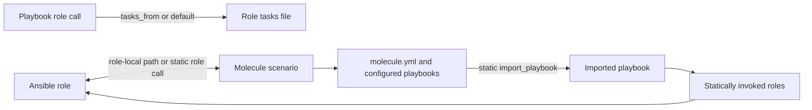
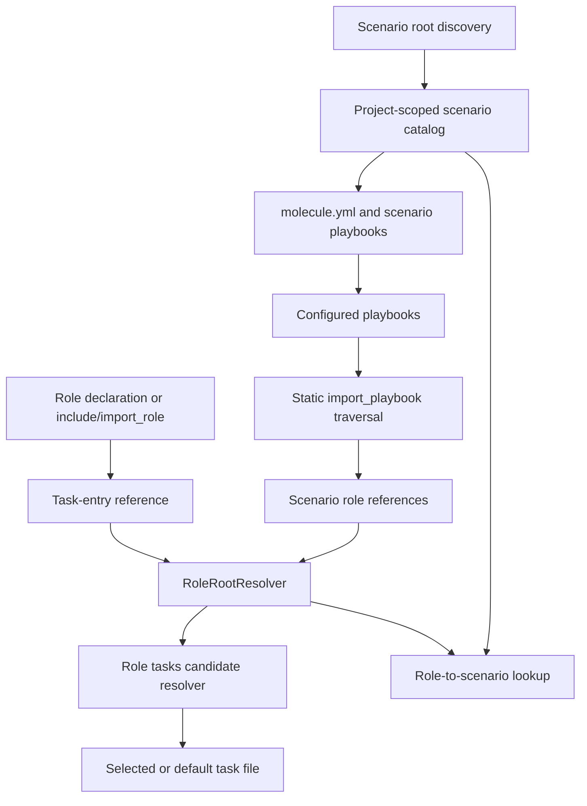

# Role Task and Molecule Navigation - Plan

## Goal Capsule

- **Objective:** Let Ansible developers move from a role invocation to the tasks it runs, and move between a role and the Molecule scenarios that exercise it.
- **Means:** Add static PSI navigation for role task entry files and discoverable links between Molecule scenarios and roles (KTD1–KTD4).
- **Product authority:** Static Ansible and Molecule project files define these links and searchable scenario information.
- **Open blockers:** None. Dynamic role or task selection remains unresolved when project files do not identify a target statically.
- **Execution profile:** Code implementation; the implementer completes the plan and reports verification. Shipping remains with the user.

## Product Contract

### Summary

Add direct navigation from playbook role calls to their effective task entry files, including calls that select `tasks_from`. Index Molecule scenarios and their authored descriptions and configuration for search and navigation, linking scenarios and roles in both directions where their relationship is statically discoverable.

### Problem Frame

A role reference currently leads to its directory, leaving the developer to locate the task entry file manually. That extra step is especially costly when an invocation selects a non-default task file. Molecule scenarios also sit apart from role navigation, making it harder to find which scenarios exercise a role and what each scenario is for.

<!-- ce-section: work-relationships -->
### How This Work Fits Together

This plan covers role task entry navigation and Molecule scenario links as one extension to the broader Ansible project navigation work in `docs/plans/2026-10-09-1825-feat-ansible-project-navigation-plan.md`. Both capabilities share resolved role identity and project role roots; module discovery, handler links, file links, and variable navigation remain separate areas of that broader work.

**Product Contract preservation:** R1, R2, F1, F2, AE1, AE2, AE4, and D1–D3 retain their meaning. R3, R4, and AE3 are clarified and expanded per the approved planning synthesis to cover standard Molecule roots, configured playbooks, and static `import_playbook` traversal; R5 and AE5 make playbook discovery explicit. R6 and AE6 make project-local collection role resolution explicit because collection scenarios can invoke roles by FQCN.

### Key Decisions

- D1. **Role calls lead to effective task entry files** (session-settled: user-directed — chosen over stopping at the role directory: the requested outcome is direct navigation to tasks, including parameterized calls). Governs R1, R2.
- D2. **Molecule scenarios are searchable project artifacts linked to roles** (session-settled: user-approved — chosen over indexing role references alone: scenario descriptions and configuration should also be discoverable). Governs R3–R6.
- D3. **Resolve only statically identifiable targets:** keep existing role-directory navigation when a dynamic value prevents selecting a task file; do not guess at runtime behavior. Governs R2, R4, R5.

### Requirements

**Role task navigation**

- R1. A playbook role declaration, `include_role`, or `import_role` call navigates directly to the role's effective task entry file; when no task file is selected, the target is the uniquely matching Ansible default `main` task file, with role-directory navigation retained if the target is missing or ambiguous.
- R2. When a role call provides a statically known `tasks_from`, navigation resolves that file relative to the role's `tasks/` directory, honoring an explicitly supplied extension or a unique matching Ansible-supported file form; dynamic, missing, or ambiguous targets do not resolve to a guessed file. Short forms and `ansible.builtin.*` forms of `include_role` and `import_role` are recognized.

**Molecule discovery and role links**

- R3. Molecule scenarios are discovered under role-local `molecule/`, project-root `molecule/`, and collection `extensions/molecule/` roots, including nested collections; each scenario directory is a distinct identity, and its name, `molecule.yml`, and authored scenario playbooks are discoverable through IDE search.
- R4. A role links to its role-local scenarios and to every scenario whose statically discovered playbooks invoke it; each scenario links to its containing role when role-local and to every invoked role, allowing multiple roles per scenario and multiple scenarios per role.
- R5. Scenario playbook discovery reads current `ansible.playbooks` and legacy `provisioner.playbooks` settings relative to the scenario directory and follows static `import_playbook` paths; dynamic paths remain unresolved.
- R6. A statically invoked role inside a project-local Ansible collection resolves from its FQCN to that collection's `roles/<role>/` directory; roles installed outside the project remain outside this plan.

### Key Flows

- F1. **Follow a role call to its tasks.** From a playbook role declaration or an `include_role`/`import_role` task, the user navigates to the role's selected task file or its default entry file. Covers R1, R2.
- F2. **Find a Molecule scenario and its role.** The user searches for a scenario by name or authored configuration/playbook text, opens its configuration or playbook, follows a role link, and can return from the role to its associated scenarios. Covers R3–R6.

### Acceptance Examples

- AE1. **Covers R1, R2.** Given a role call without `tasks_from`, navigation opens the unique default task entry file; if neither default filename exists or both are present, it opens the role directory. Given `tasks_from: install`, it opens the unique corresponding file under `tasks/`; a call using `ansible.builtin.include_role` behaves the same as the short form.
- AE2. **Covers R2.** Given a variable-valued `tasks_from`, a selected file that does not exist, or multiple matching files, navigation does not point to an unrelated task file; the role name remains navigable to the role directory.
- AE3. **Covers R3–R5.** Given a Molecule scenario whose configured converge playbook imports a static project playbook that invokes two roles, searching for text in the scenario config finds the scenario, opening either role exposes the scenario, and opening the scenario exposes both roles.
- AE4. **Covers R3, R4.** Given multiple scenarios for one role, including same-named scenarios in different scenario directories, each remains separately searchable and navigable from the role.
- AE5. **Covers R3, R5.** Given role-local, project-root, and collection `extensions/molecule/` scenarios, each scenario is discovered; playbook paths configured with either `ansible.playbooks` or legacy `provisioner.playbooks` resolve relative to their scenario directory.
- AE6. **Covers R4, R6.** Given a collection scenario that invokes a role by FQCN, navigation resolves to that role under the containing project-local collection, and the role exposes the scenario backlink.

### Scope Boundaries

- Molecule execution, test result reporting, and Molecule CLI integration are deferred.
- Runtime evaluation of Jinja, variables, or dynamically selected roles and task files is outside this work.
- Indexing arbitrary documentation outside Molecule scenario configuration and playbooks is outside this work.

## Planning Contract

### Key Technical Decisions

- KTD1. **Keep role identity navigation and task-entry navigation as separate targets.** A role-call token uses a context-aware task reference that opens only the effective task file when one resolves; generic role references and Find Usages retain the role-directory identity, with that directory as the call-site fallback (R1, R2, D1).
- KTD2. **Extend the canonical role resolver for project-local collections.** Reuse `RoleRootResolver` for ordinary and configured role roots, and teach it to map project-local collection FQCNs to their collection `roles/<role>/` directory; do not add a separate role path policy (R1–R6).
- KTD3. **Discover scenarios at project scope, resolve references at file scope.** Keep scenario-root discovery and reverse role-to-scenario lookup out of per-keystroke reference resolution; use the project file index and a project-scoped scenario catalog where needed, refreshed when project files change (R3–R6).
- KTD4. **Follow only static playbook imports.** Resolve configured playbooks and recursively follow statically known `import_playbook` paths with cycle protection. Keep each role edge attached to the originating scenario directory even when scenarios share an imported playbook (R4, R5, D3).

### High-Level Technical Design

The design reuses the plugin's PSI reference path for direct links and keeps project-wide scenario discovery separate from scalar reference resolution.

### Assumptions and Deferred Decisions

- Ansible's standard scenario directories and the current/legacy Molecule playbook settings are sufficient; arbitrary custom scenario roots are not part of this plan.
- Project-local collection roots are identified through their collection metadata or standard `ansible_collections/<namespace>/<collection>/` layout; installed Galaxy collections outside the project are not indexed.
- Static `import_playbook` paths can be resolved from project files. Variable-based or templated paths remain unresolved under R5.
- Searchability uses the IDE's project file/text search for scenario files and authored content; plugin-specific ranking or a new search UI is not required by R3.

### Context & Research

- `src/main/java/ir/msdehghan/plugins/ansible/model/ansible/role/RoleInvocationType.java` — `tasks_from` is currently modeled as a string without a file reference.
- `src/main/java/ir/msdehghan/plugins/ansible/reference/RoleNameReference.java` — current role navigation resolves to role directories.
- `src/main/java/ir/msdehghan/plugins/ansible/reference/RoleRootResolver.java` — current shared resolution for local and configured role roots.
- `src/main/java/ir/msdehghan/plugins/ansible/model/ansible/task/AnsibleTask.java` — current `include_role` and `import_role` recognition.
- `src/main/java/ir/msdehghan/plugins/ansible/model/ansible/play/AnsiblePlay.java` — current playbook model and static `import_playbook` reference behavior.
- `src/main/java/ir/msdehghan/plugins/ansible/AnsibleUtil.java` — current Ansible file recognition does not cover mapping-root Molecule config.
- `src/test/java/ir/msdehghan/plugins/ansible/TestAnsibleNavigationReferences.java` and `src/test/java/ir/msdehghan/plugins/ansible/TestRoleReference.java` — existing navigation coverage does not yet verify task entry or Molecule links.

### Sources & References
- [Ansible role reuse documentation](https://docs.ansible.com/projects/ansible-core/devel/playbook_guide/playbooks_reuse_roles.html) — supported default role task entry file forms.
- [Ansible `include_role` documentation](https://docs.ansible.com/projects/ansible-core/2.19/collections/ansible/builtin/include_role_module.html) and [Ansible `import_role` documentation](https://docs.ansible.com/projects/ansible-core/2.19/collections/ansible/builtin/import_role_module.html) — `tasks_from` selects a file in the role's `tasks/` directory and defaults to `main`.
- [Molecule configuration documentation](https://docs.ansible.com/projects/molecule/configuration/) — current `ansible.playbooks` and legacy `provisioner.playbooks` configuration and scenario paths.
- [Molecule role testing](https://docs.ansible.com/projects/molecule/getting-started-roles/) and [Molecule collection layout](https://docs.ansible.com/projects/molecule/ansible-native/) — role-local, project, and collection scenario locations.
- [Ansible collection role structure and FQCNs](https://docs.ansible.com/projects/ansible/latest/dev_guide/migrating_roles.html) — collection roles live under the collection's `roles/` directory and are referenced by namespace, collection, and role name.

## Implementation Units

### U1. Navigate role calls to task entry files

**Goal:** Make role invocations navigate to their selected task file or default task entry while preserving role-directory navigation.

**Requirements:** R1, R2, R6; F1; AE1, AE2, AE6.

**Dependencies:** None.

**Files:**
- `src/main/java/ir/msdehghan/plugins/ansible/model/ansible/role/RoleInvocationType.java`
- `src/main/java/ir/msdehghan/plugins/ansible/model/ansible/role/Role.java`
- `src/main/java/ir/msdehghan/plugins/ansible/reference/RoleNameReference.java`
- `src/main/java/ir/msdehghan/plugins/ansible/reference/RoleRootResolver.java`
- `src/test/java/ir/msdehghan/plugins/ansible/TestAnsibleNavigationReferences.java`
- `src/test/java/ir/msdehghan/plugins/ansible/TestRoleReference.java`
- `src/test/java/ir/msdehghan/plugins/ansible/reference/RoleRootResolverTest.java`

**Approach:**
1. Reuse and extend `RoleRootResolver` to resolve ordinary roles from project `roles/` and configured `roles_path` roots, plus project-local collection roles from their FQCN and collection root.
2. Resolve a statically known `tasks_from` relative to that role's `tasks/` directory; for omitted `tasks_from`, use the unique supported `main` task entry.
3. Keep directory navigation when task selection is dynamic, missing, or ambiguous, and preserve existing role-directory references and usage behavior.
4. Keep short and `ansible.builtin.*` `include_role` and `import_role` recognition on the existing `AnsibleTask` mapping path.

**Patterns to follow:** `RoleNameReference`, `RoleRootResolver`, `AnsibleReferenceProvider`, and existing `BasePlatformTestCase` navigation tests.

**Test scenarios:**
- Covers AE1. A playbook role declaration without `tasks_from` navigates to the unique default task file.
- Covers AE1. A playbook role declaration with a static `tasks_from` navigates to that task file.
- Covers AE1. Short-form and FQCN `include_role` and `import_role` calls with `tasks_from` navigate to the selected task file.
- Covers AE6. An FQCN role call inside a project-local collection resolves to that collection's role directory before selecting its task file.
- `RoleRootResolver` maps a project-local `namespace.collection.role` name to the role directory under that collection and ignores similarly named roles outside the project.
- Covers AE2. Variable-valued, missing, ambiguous, or unsupported task file targets retain role-directory navigation.
- Go to Declaration from a role-call token selects the effective task file rather than presenting the role directory as a competing target; Find Usages still identifies the role invocation.
- Existing generic role-name references continue to resolve the role directory.

**Verification:** Task-file navigation selects only the role's unique effective task entry; existing directory navigation assertions remain valid.

### U2. Discover Molecule scenarios and their playbooks

**Goal:** Recognize scenario directories, mapping-shaped configuration, and configured playbooks across the supported project layouts.

**Requirements:** R3, R5; F2; AE4, AE5.

**Dependencies:** None.

**Files:**
- `src/main/java/ir/msdehghan/plugins/ansible/AnsibleUtil.java`
- New Molecule scenario discovery/model classes under `src/main/java/ir/msdehghan/plugins/ansible/`
- `src/test/java/ir/msdehghan/plugins/ansible/TestMoleculeNavigationReferences.java`

**Approach:**
1. Discover role-local, project-root, and collection `extensions/molecule/` scenario directories, including nested collections; use the scenario directory as identity.
2. Recognize `molecule.yml` separately from sequence-root Ansible playbooks so its mapping-root content is searchable and navigable as scenario content.
3. Read current `ansible.playbooks` and legacy `provisioner.playbooks`, resolving configured paths from the scenario directory.
4. Reuse existing Ansible playbook PSI handling for configured playbooks and follow statically resolved `import_playbook` paths with cycle protection.

**Patterns to follow:** `AnsibleUtil.isInAnsibleFile`, `AnsiblePlay`, project-aware PSI resolution, and test fixture setup through `AnsibleTestProjectSupport.addProjectFile`.

**Test scenarios:**
- Covers AE5. Role-local, project-root, collection, and nested-collection scenario roots are discovered as separate scenario identities.
- Covers AE5. Current `ansible.playbooks` paths resolve relative to the scenario directory.
- Covers AE5. Legacy `provisioner.playbooks` paths resolve relative to the scenario directory.
- A scenario directory name and authored `molecule.yml` text are both discoverable through IDE file/text search.
- Covers R5. A configured playbook's static `import_playbook` target is included once; an import cycle terminates without looping.
- Mapping-root `molecule.yml` is recognized while unrelated YAML mappings are not misclassified as scenario files.

**Verification:** Every supported scenario root produces one stable scenario entry, configured playbooks resolve in scenario context, and repeated or cyclic imports do not duplicate or stall discovery.

### U3. Link scenarios and roles in both directions

**Goal:** Expose statically discoverable scenario-role relationships from both scenario files and role navigation.

**Requirements:** R3–R6; F2; AE3–AE6.

**Dependencies:** U1, U2.

**Files:**
- New Molecule scenario-role reference/catalog classes under `src/main/java/ir/msdehghan/plugins/ansible/reference/`
- `src/main/java/ir/msdehghan/plugins/ansible/reference/AnsibleReferenceContributor.java`
- `src/main/java/ir/msdehghan/plugins/ansible/reference/AnsibleReferenceProvider.java`
- `src/test/java/ir/msdehghan/plugins/ansible/TestMoleculeNavigationReferences.java`

**Approach:**
1. Attach role references in scenario playbooks to the shared role-root resolution path, including project-local collection roles resolved by FQCN.
2. Provide role-to-scenario lookup from the project-scoped scenario catalog, including role-local scenarios and scenarios discovered through configured or statically imported playbooks.
3. Preserve scenario identity per directory when several scenarios use the same imported playbook or share a display name.
4. Keep filesystem discovery out of each reference resolution request; update the project-scoped catalog as files change.

**Patterns to follow:** `AnsibleReferenceContributor`, `AnsibleReferenceProvider`, `RoleNameReference`, and project-scoped caching used by `RoleRootResolver`.

**Test scenarios:**
- Covers AE3. A scenario using one directly configured playbook and one statically imported playbook links to both invoked roles.
- Covers AE3. Each invoked role exposes the scenario as a backlink.
- Covers AE4. Multiple and same-named scenarios remain distinct when listed from a role.
- A role-local scenario links to its containing role even when no playbook role call is present.
- Covers AE6. A collection scenario links to an FQCN role in the same project-local collection and the role shows the backlink.
- Dynamic role names and dynamic imported playbook paths do not create guessed links.

**Verification:** Scenario-to-role and role-to-scenario navigation agree for every statically discovered relationship, while distinct scenario directories remain independently navigable.

## System-Wide Impact

- Role references change their destination only in the role-call task-navigation context; generic role-name links continue to resolve the role directory (KTD1).
- Molecule `molecule.yml` requires file-shape recognition separate from the current sequence-root Ansible-file check. Scenario playbooks continue to use the existing playbook parser and references.
- Role-root discovery remains centralized through `RoleRootResolver`, so role calls and scenario backlinks share configured, local, and project-local collection role behavior.
- Scenario discovery affects project indexing, search, and reverse navigation. The catalog must be project-scoped and refresh when scenario config, playbooks, imports, or role roots change; full project scans must not run on every PSI reference lookup.

## Risks & Dependencies

- **Multiple supported file forms:** default task entry lookup can find more than one candidate. Preserve directory fallback when the candidate is not unique (R1, R2).
- **Static import graph cycles or shared playbooks:** guard recursion against cycles and keep relationship ownership at the scenario directory (KTD4).
- **Scenario catalog freshness:** cached project discovery can become stale after VFS edits. Include invalidation or refresh coverage in U2 and U3.
- **Collection path ambiguity:** FQCN lookup must distinguish a project-local collection from installed collections outside the project; limit resolution to project collection roots identified under KTD2.
- **Scope of scenario roots:** Molecule permits repository-specific layouts beyond the documented conventions. This plan supports the roots in R3 and requires no custom root setting.

## Verification Contract

The implementation adds focused IntelliJ platform tests in `TestAnsibleNavigationReferences`, `TestRoleReference`, and `TestMoleculeNavigationReferences`. The repository CI build uses `./gradlew build --info`; the plan's feature evidence is the passing focused navigation tests plus the full build and plugin verification gate `./gradlew verifyPlugin --info`.

## Definition of Done

- All requirements R1–R6 and acceptance examples AE1–AE6 are covered by implementation and focused tests.
- Existing role-directory navigation and Find Usages behavior remains covered and passes.
- Scenario discovery covers the supported roots, configured playbook keys, and static import traversal, including cycle and distinct-identity cases.
- The repository build and plugin verification gate pass.
